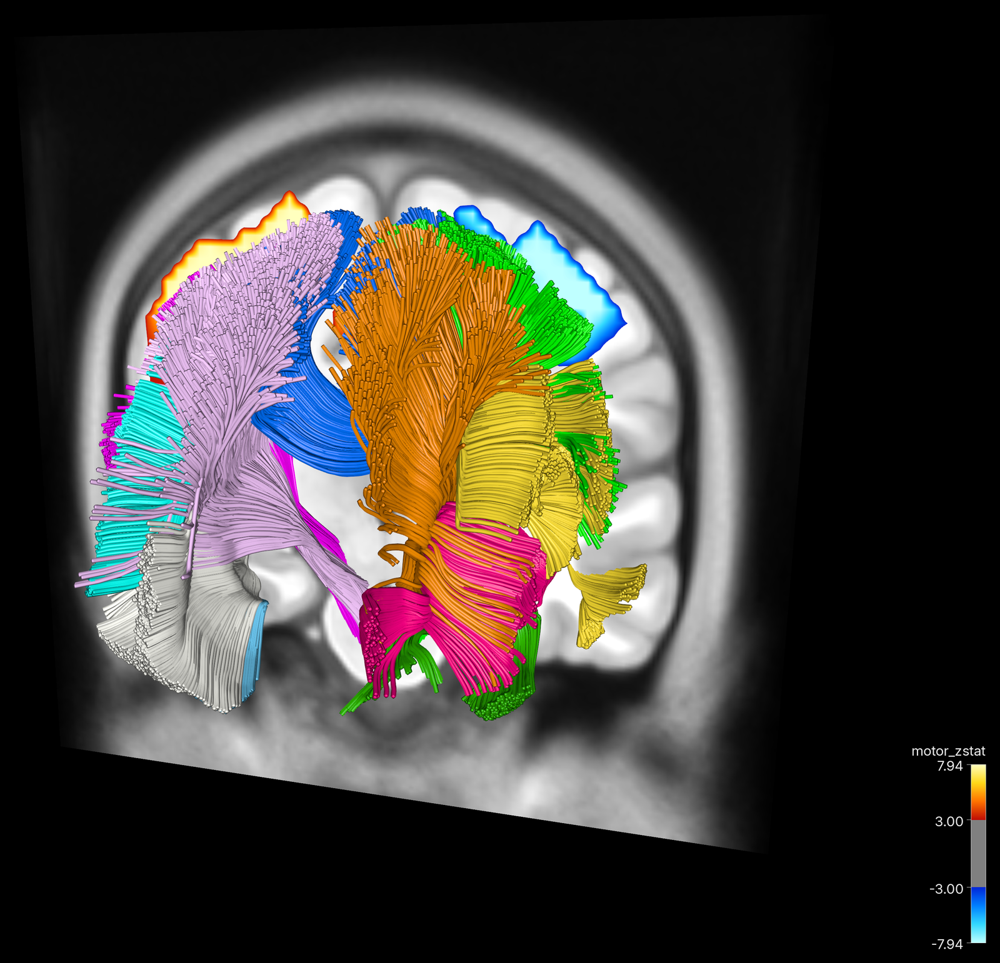
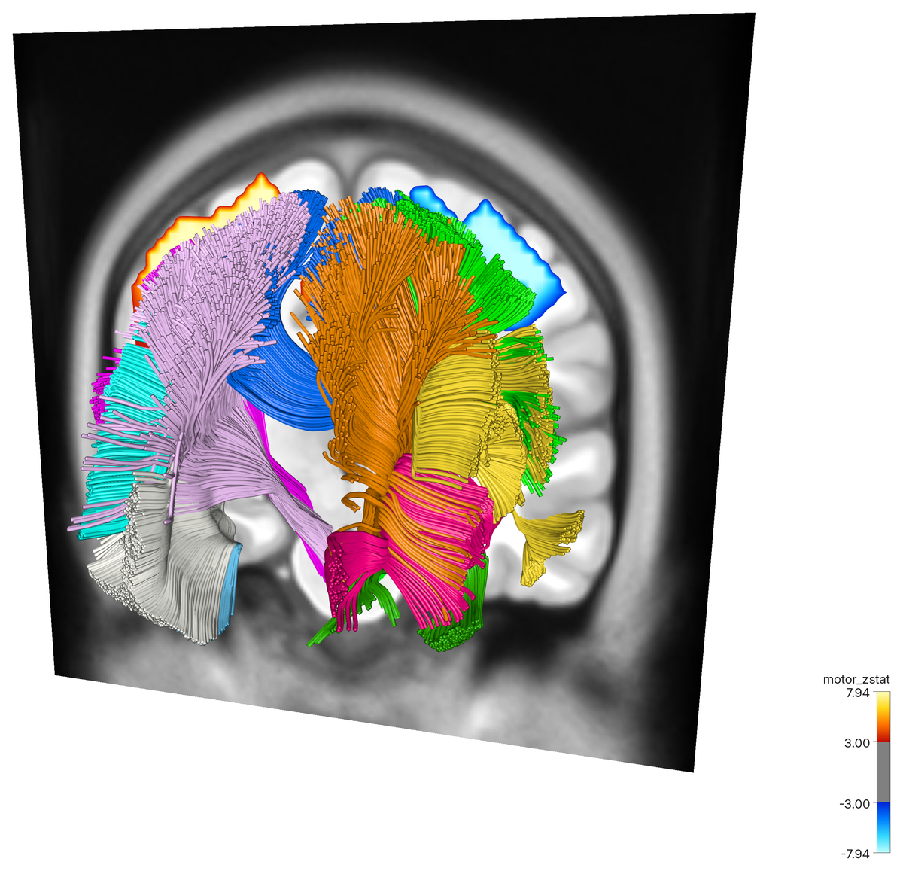
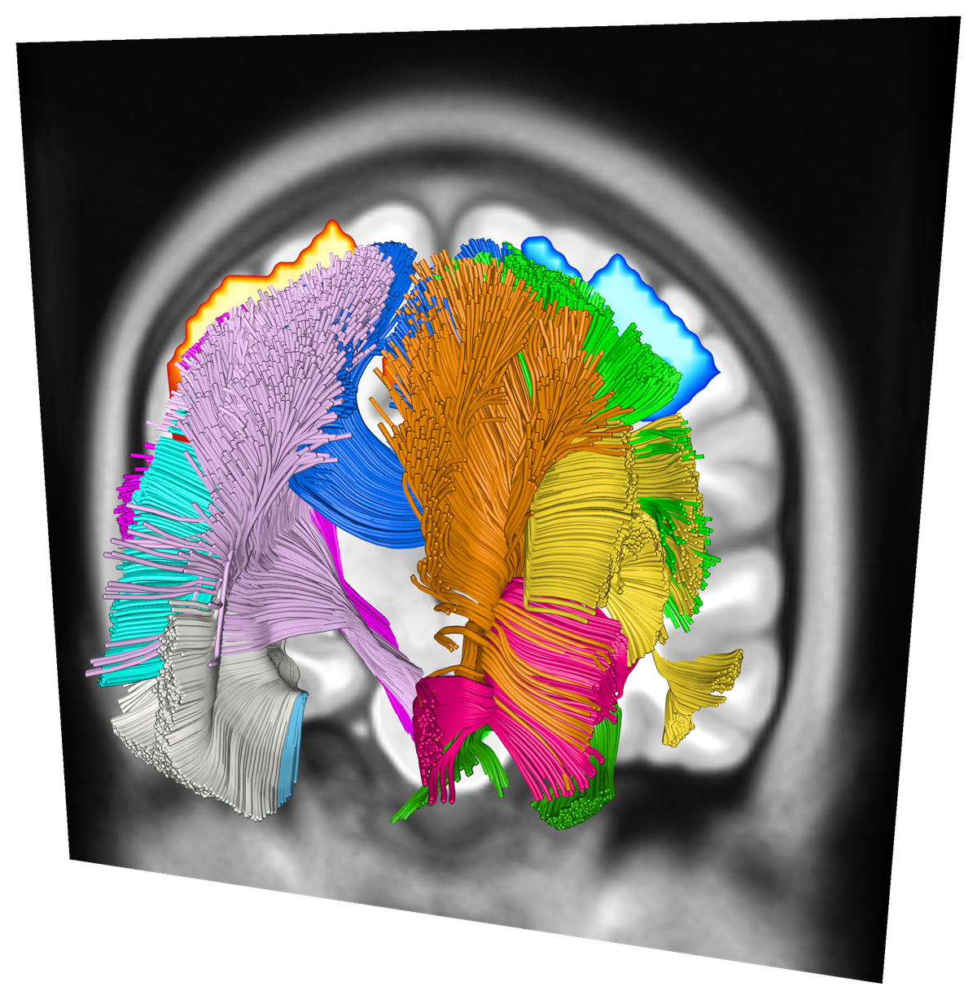
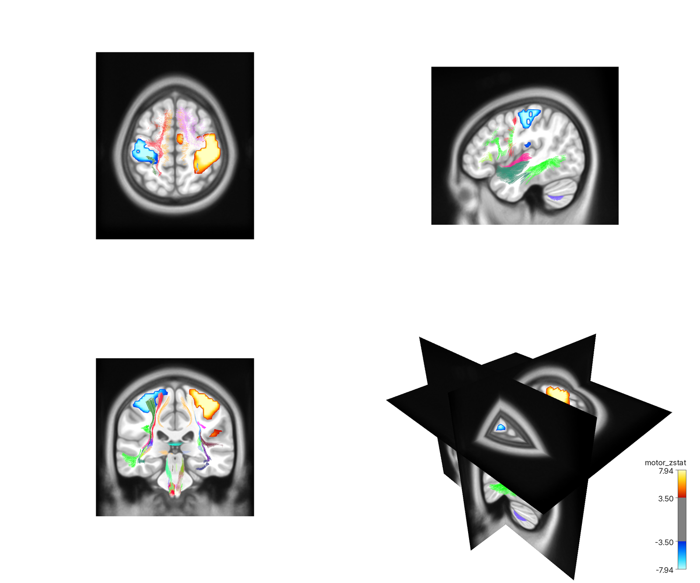
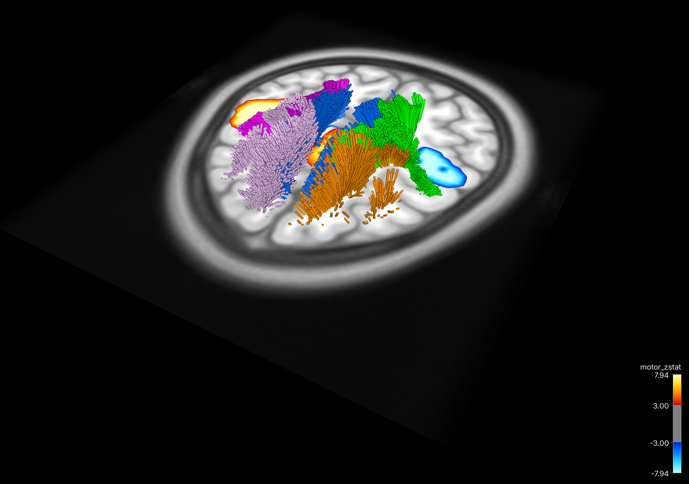
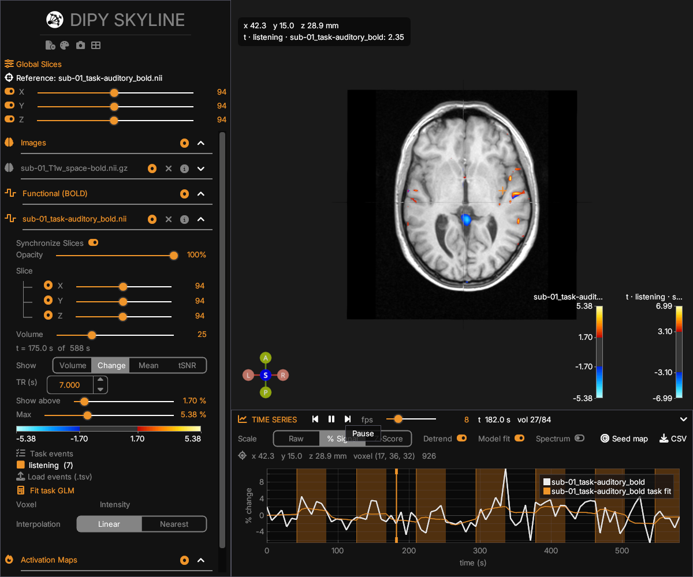

<h1 align="center">Skyline fMRI</h1>

<p align="center">
  <b>Activation, anatomy and white-matter tracts in one scene, captured as figures ready for your paper.</b><br>
  Built on <a href="https://dipy.org">DIPY</a> Skyline and <a href="https://fury.gl">FURY</a>.
</p>

<p align="center">
  
</p>

<p align="center"><i>A group motor map on the MNI template, with eleven HCP842 atlas bundles, rendered straight from the viewer at 3x resolution.</i></p>

---

## Why Skyline fMRI

Making a good neuroimaging figure often takes three tools and an image editor:
one to threshold the activation map, one to draw tracts, one to arrange views.
Skyline fMRI does it in a single GPU-accelerated viewer:

- **Activation maps** (t, z, r): threshold, saturation, positive/negative
  tails, minimum cluster size, six colormaps and a cluster table that jumps to
  each peak.
- **Tracts linked to activation**: load a bundle atlas and every cluster lists
  the tracts that cross it, by name (*Corticospinal tract (left)*). One click
  isolates only the streamlines that pass through the activation.
- **BOLD runs**: play a run as a movie of percent signal change over the
  anatomy, click any voxel for its time series with task blocks and the model
  fit, fit a task GLM or seed a correlation map in the viewer.
- **2D triplanar views**: axial, sagittal and coronal panels next to the 3D
  view, with tracts cut to a slab around each slice.
- **Diffusion data**: FA maps, peaks, ODF glyphs, ROIs and surfaces from DIPY,
  in the same world space.

## Capture figures for research papers

<table>
  <tr>
    <td width="50%"></td>
    <td width="50%"></td>
  </tr>
  <tr>
    <td align="center"><i>White background for print</i></td>
    <td align="center"><i>Transparent background, ready to drop on a poster</i></td>
  </tr>
</table>

Click the **camera** in the sidebar and choose:

| Option | Choices |
|---|---|
| Resolution | 1x, 2x or 4x the on-screen views |
| Background | scene color, white, black or transparent |
| Color scale | labelled color bar for every activation map |
| Cursor | keep or hide the crosshair |
| Separate views | one file per triplanar panel, plus the composed figure |

The views are re-rendered offscreen, so the sidebar never appears in your
figure. The same capture is one line of Python, which makes figures
reproducible:

```python
viewer.capture_figure("figure2.png", scale=4, background="white", panels=True)
```

<p align="center">
  
</p>
<p align="center"><i>Triplanar layout: activation in every panel, tracts cut to a 10 mm slab around each slice.</i></p>

<p align="center">
  
</p>
<p align="center"><i>Corticospinal tracts reaching the motor activation through an axial slice.</i></p>

## The viewer

<p align="center">
  
</p>
<p align="center"><i>Auditory task run: percent change overlay while playing, task GLM t-map, and the time series under the cursor with the listening blocks and the model fit.</i></p>

## Install

```bash
pip install git+https://github.com/Atharva-Shah-2298/skyline-fmri.git
```

This pulls in [DIPY](https://dipy.org), [FURY](https://fury.gl) 2.1 and
`imgui_bundle`. Python 3.12 or newer, and a GPU with Vulkan, Metal or
DirectX 12 support.

## Quick start

Download the example data once:

```bash
dipy_fetch mni_template bundle_atlas_hcp842
pip install nilearn  # only for the SPM auditory example
python -c "from nilearn.datasets import fetch_spm_auditory; fetch_spm_auditory()"
```

**Activation with a tract atlas** (MNI space):

```bash
skyline_fmri ~/.dipy/mni_template/mni_icbm152_t1_tal_nlin_asym_09c.nii \
    ~/.dipy/bundle_atlas_hcp842/Atlas_30_Bundles/bundles \
    --stat_maps zstat1.nii.gz --tract_colors random --layout triplanar
```

**A task run with events**:

```bash
skyline_fmri T1w.nii.gz --bold sub-01_task-auditory_bold.nii \
    --events sub-01_task-auditory_events.tsv
```

**From Python**:

```python
from skyline_fmri import skyline

skyline(
    images=[(t1, affine, "T1w.nii.gz")],
    stat_maps=[(zmap, affine, "zstat1.nii.gz")],
    functional=[(bold, affine, "bold.nii.gz", 2.0)],
    events="events.tsv",
    layout="triplanar",
)
```

Every option is described in [`docs/usage.rst`](docs/usage.rst) and in
`skyline_fmri --help`.

## Citing

If Skyline fMRI helps your work, please cite it together with DIPY and FURY.
GitHub's **Cite this repository** button gives the formatted entries from
[`CITATION.cff`](CITATION.cff).

```bibtex
@software{shah2026skylinefmri,
  author = {Shah, Atharva},
  title  = {Skyline fMRI: functional, structural and diffusion MRI visualization built on DIPY Skyline},
  year   = {2026},
  url    = {https://github.com/Atharva-Shah-2298/skyline-fmri},
  version = {0.1.0}
}

@article{garyfallidis2014dipy,
  author  = {Garyfallidis, Eleftherios and Brett, Matthew and Amirbekian, Bagrat and Rokem, Ariel and van der Walt, Stefan and Descoteaux, Maxime and Nimmo-Smith, Ian and {DIPY Contributors}},
  title   = {DIPY, a library for the analysis of diffusion MRI data},
  journal = {Frontiers in Neuroinformatics},
  volume  = {8},
  pages   = {8},
  year    = {2014},
  doi     = {10.3389/fninf.2014.00008}
}

@article{garyfallidis2021fury,
  author  = {Garyfallidis, Eleftherios and Koudoro, Serge and Guaje, Javier and C{\^o}t{\'e}, Marc-Alex and Biswas, Soham and Reagan, David and Anousheh, Nasim and Silva, Filipi and Fox, Geoffrey and {FURY Contributors}},
  title   = {FURY: advanced scientific visualization},
  journal = {Journal of Open Source Software},
  volume  = {6},
  number  = {64},
  pages   = {3384},
  year    = {2021},
  doi     = {10.21105/joss.03384}
}
```

## Credits

Skyline fMRI extends [DIPY](https://github.com/dipy/dipy) Skyline and renders
with [FURY](https://github.com/fury-gl/fury) and
[pygfx](https://github.com/pygfx/pygfx). The figures use the MNI ICBM 2009c
template, the HCP842 bundle atlas (Yeh et al., 2018,
doi:10.1016/j.neuroimage.2018.05.027), the SPM auditory dataset, and a sample
motor map distributed with nilearn. Code is released under DIPY's BSD license
(see [`LICENSE`](LICENSE)).
