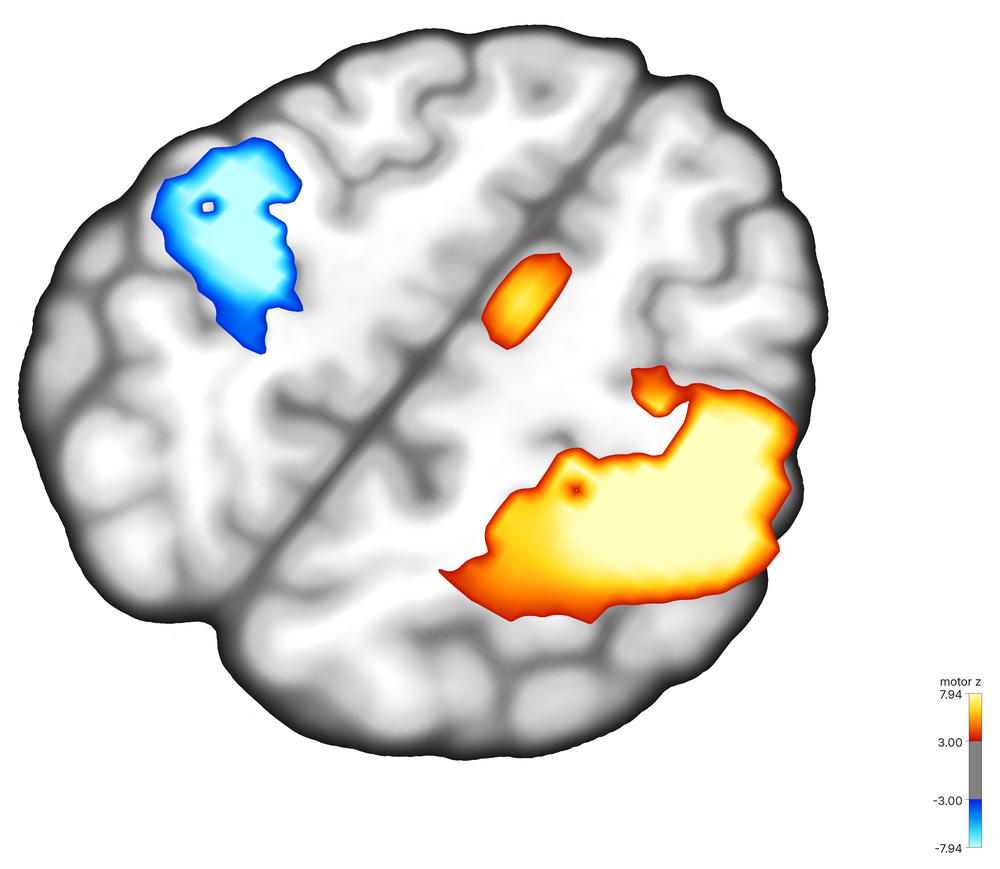
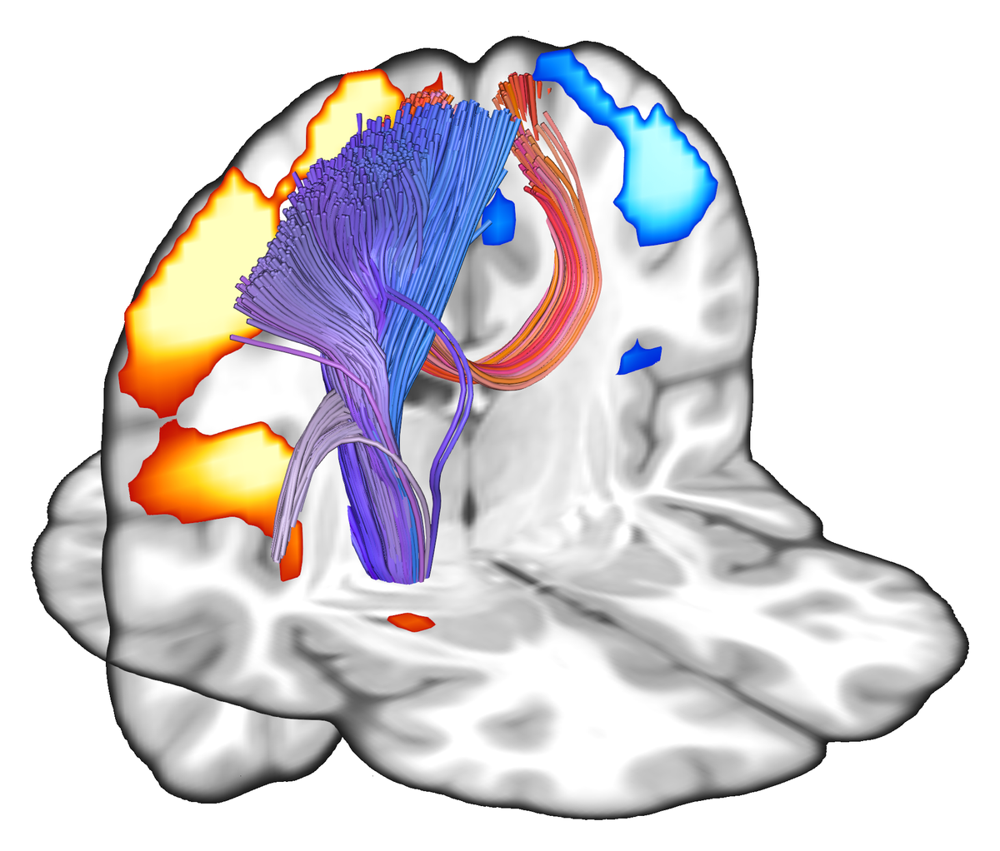
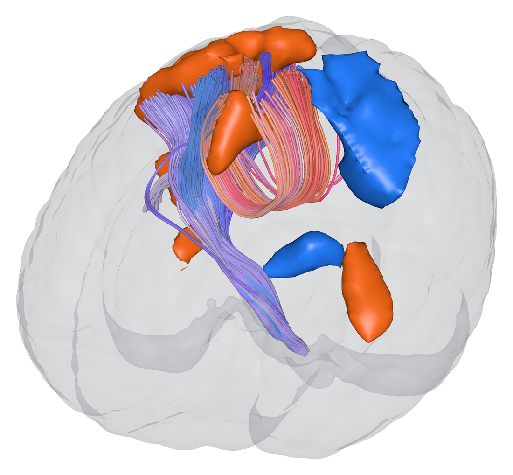
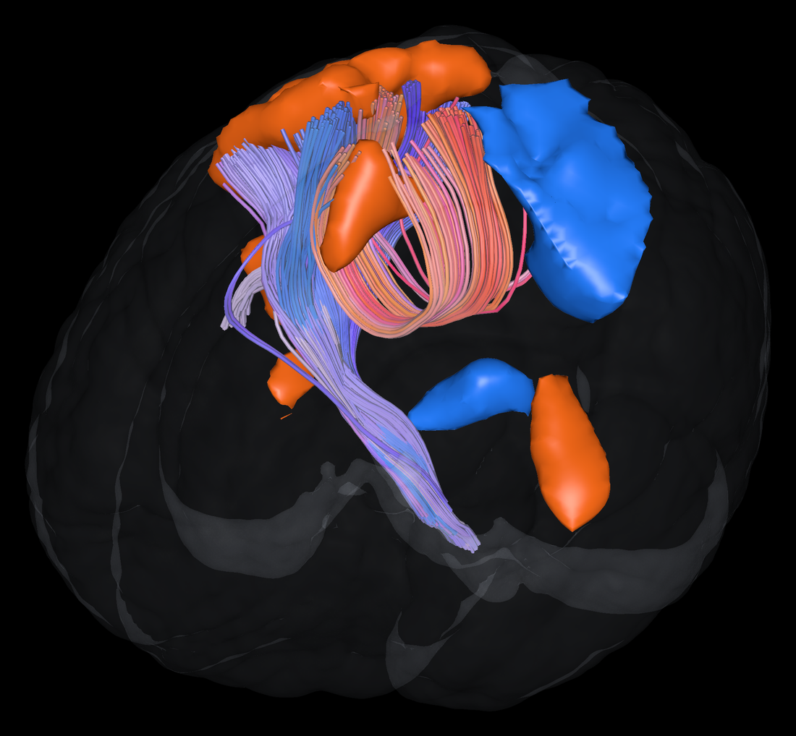
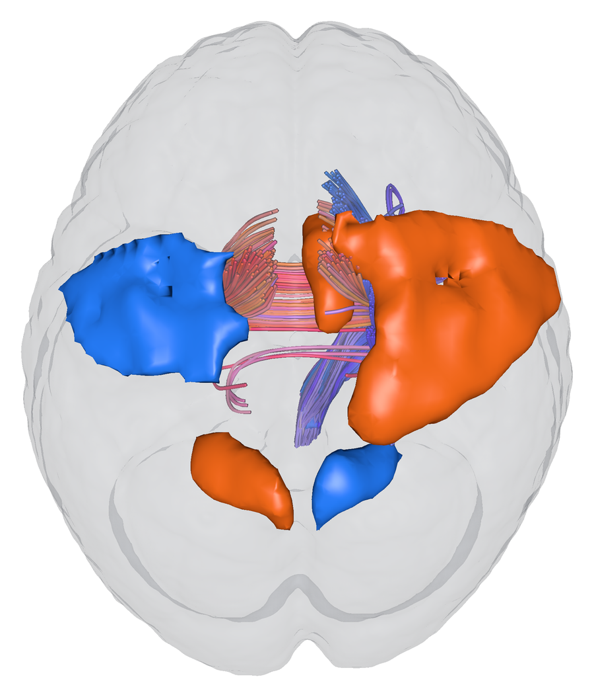
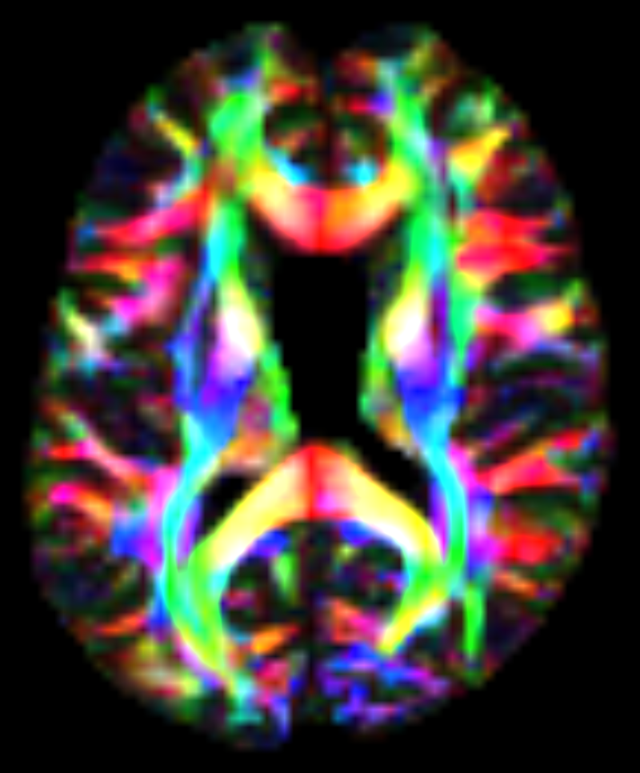

<h1 align="center">Skyline fMRI</h1>

<p align="center">
  <b>Activation maps, anatomy and white-matter tracts in one scene, captured as figures ready for your paper.</b>
</p>

<p align="center">
  
</p>

<p align="center"><i>Motor z-map (|z| &gt; 3, clusters of 30+ voxels) on the MNI template with both corticospinal tracts of the HCP842 atlas. Captured from the viewer at 3x on a white background.</i></p>

---

Skyline fMRI is an interactive, GPU-accelerated viewer for functional, structural
and diffusion MRI. It loads NIfTI images, BOLD runs, statistical maps,
tractograms, surfaces and ROIs into the same world space, and exports what
you see at print resolution. Every figure on this page was made with it.

| | |
|---|---|
| [Figures for papers](#figures-for-papers) | white, black or transparent backgrounds at 1x to 4x |
| [Activation maps](#activation-maps) | threshold, cluster size, colorbars, cluster table |
| [Tracts through activation](#tracts-through-activation) | which bundles cross a cluster, isolated in one click |
| [Glass brains](#glass-brains) | translucent brain with 3D clusters and tracts inside |
| [BOLD time series](#bold-time-series) | play a run, click a voxel, fit a task GLM |
| [Triplanar views](#triplanar-views) | axial, sagittal and coronal panels next to 3D |
| [Diffusion data](#diffusion-data) | FA and color FA maps, peaks, ODFs, tractography |

## Figures for papers

<table>
  <tr>
    <td width="50%"></td>
    <td width="50%"></td>
  </tr>
  <tr>
    <td align="center"><i>Black background for slides</i></td>
    <td align="center"><i>Transparent PNG for posters and composite figures</i></td>
  </tr>
</table>

The camera button in the sidebar opens **Capture Figure**:

| Option | Choices |
|---|---|
| Resolution | 1x, 2x or 4x the size of the views on screen |
| Background | scene color, white, black or transparent |
| Color scale | labelled color bar for every activation map |
| Cursor | keep or hide the crosshair |
| Separate views | one file per triplanar panel, plus the composed figure |

The views are rendered again offscreen, so the sidebar never ends up in the
figure. Turn on **Transparent background** in an image's controls to drop the
black frame around the head, so slices sit cleanly on white or transparent
pages. The same capture is one line of Python, which keeps figures
reproducible:

```python
viewer.capture_figure("figure2.png", scale=4, background="white", panels=True)
```

## Activation maps

<p align="center">
  
</p>

Load t, z or r maps with `--stat_maps`. Each map has a threshold, a saturation
value, positive / negative / both tails, a minimum cluster size and six
colormaps. The cluster table lists every cluster with its size, peak value and
peak coordinate in mm; clicking a row moves the slices to the peak.

## Tracts through activation

<p align="center">
  
</p>

Load a bundle atlas next to an activation map and every cluster lists the
tracts that cross it, by name (*Corticospinal tract (right)*), with the number
of streamlines and the share of the tract. One click adds a layer with only
the streamlines that pass through the activation. Above: the right
corticospinal and frontopontine tracts and the middle corpus callosum,
restricted to the streamlines that reach the right motor cortex cluster.

## Glass brains

<table>
  <tr>
    <td width="50%"></td>
    <td width="50%"></td>
  </tr>
</table>

<p align="center">
  
</p>

`--glass_brain` wraps the scene in a translucent shell of the brain, turns the
clusters of every activation map into smooth 3D surfaces (orange positive,
blue negative) and hides the slices, so tracts and activation are seen in
depth. From the sidebar, **Glass brain** in an image's controls and
**3D clusters** under a map's cluster table do the same one layer at a time;
the shell and clusters are ordinary layers whose opacity and color can be
changed.

```python
viewer.add_glass_brain()
viewer.add_activation_blobs()
```

## BOLD time series

<p align="center">
  
</p>

Load a run with `--bold` and its events with `--events`. Press play to watch
percent signal change over the anatomy, click any voxel to plot its time series
with the task blocks and the fitted response, and switch between raw, percent
signal and z-scored traces or the power spectrum. **Fit task GLM** adds one
t-map per condition; **Seed map** adds the correlation map of the picked voxel.
Above: the SPM auditory run, its t-map, and the peak voxel following the
listening blocks.

## Triplanar views

<p align="center">
  
</p>

`--layout triplanar` (or the layout button) shows axial, sagittal and coronal
2D views beside the 3D view. Clicking a 2D view moves every slice to that
point. Activation maps are drawn in every view, and tracts are cut to a 10 mm
slab around each slice so they do not hide it.

## Diffusion data

<p align="center">
  
</p>

Diffusion data from DIPY share the same scene: scalar and RGB maps such as the
color FA above (Stanford HARDI), peaks, ODF glyphs, tractograms with
clustering, ROIs and surfaces.

## Install

```bash
pip install git+https://github.com/Atharva-Shah-2298/skyline-fmri.git
```

This pulls in [DIPY](https://dipy.org), [FURY](https://fury.gl) 2.1 and
`imgui_bundle`. Python 3.12 or newer, and a GPU with Vulkan, Metal or
DirectX 12 support.

## Quick start

Download the example data once:

```bash
dipy_fetch mni_template bundle_atlas_hcp842
pip install nilearn  # only for the SPM auditory example
python -c "from nilearn.datasets import fetch_spm_auditory; fetch_spm_auditory()"
```

**Activation with a tract atlas** (MNI space):

```bash
skyline_fmri ~/.dipy/mni_template/mni_icbm152_t1_tal_nlin_asym_09c.nii \
    ~/.dipy/bundle_atlas_hcp842/Atlas_30_Bundles/bundles \
    --stat_maps zstat1.nii.gz --layout triplanar
```

**Glass brain**:

```bash
skyline_fmri T1w_brain.nii.gz ~/.dipy/bundle_atlas_hcp842/Atlas_30_Bundles/bundles \
    --stat_maps zstat1.nii.gz --glass_brain
```

**A task run with events**:

```bash
skyline_fmri T1w.nii.gz --bold sub-01_task-auditory_bold.nii \
    --events sub-01_task-auditory_events.tsv
```

**From Python**:

```python
from skyline_fmri import skyline

viewer = skyline(
    images=[(t1, affine, "T1w.nii.gz")],
    stat_maps=[(zmap, affine, "zstat1.nii.gz")],
    functional=[(bold, affine, "bold.nii.gz", 2.0)],
    events="events.tsv",
    layout="triplanar",
)
```

Every option is described in [`docs/usage.rst`](docs/usage.rst) and in
`skyline_fmri --help`.

## Citing

If Skyline fMRI helps your work, please cite it. GitHub's
**Cite this repository** button gives the formatted entry from
[`CITATION.cff`](CITATION.cff).

```bibtex
@software{shah2026skylinefmri,
  author  = {Shah, Atharva},
  title   = {Skyline fMRI: functional, structural and diffusion MRI visualization},
  year    = {2026},
  url     = {https://github.com/Atharva-Shah-2298/skyline-fmri},
  version = {0.1.0}
}
```

Skyline fMRI is built on DIPY and FURY; please also cite them:

- Garyfallidis E. et al. *DIPY, a library for the analysis of diffusion MRI
  data.* Frontiers in Neuroinformatics 8:8 (2014).
  [doi:10.3389/fninf.2014.00008](https://doi.org/10.3389/fninf.2014.00008)
- Garyfallidis E. et al. *FURY: advanced scientific visualization.* Journal of
  Open Source Software 6(64):3384 (2021).
  [doi:10.21105/joss.03384](https://doi.org/10.21105/joss.03384)

## Data in the figures

MNI ICBM 2009c template; HCP842 bundle atlas (Yeh et al., NeuroImage 2018,
[doi:10.1016/j.neuroimage.2018.05.027](https://doi.org/10.1016/j.neuroimage.2018.05.027));
motor sample map and SPM auditory dataset distributed with nilearn; Stanford
HARDI dataset distributed with DIPY.

## License

BSD 3-Clause, see [`LICENSE`](LICENSE).
